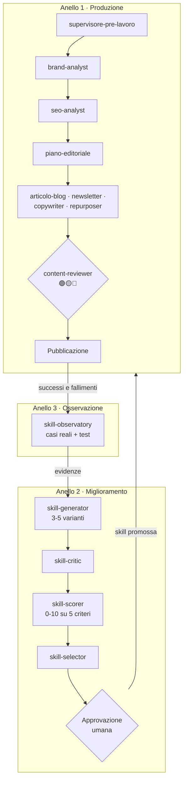
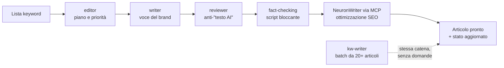

# Sistema contenuti AI — 23 skill di Claude che producono e migliorano sé stesse

**Un sistema di skill per Claude che porta un brand dall'onboarding al contenuto pubblicato e misurato, e che fa evolvere le proprie skill sulla base dei casi reali invece che delle intuizioni.**

> 🔒 Le skill sono materiale riservato e i clienti sono anonimizzati. Questa pagina descrive l'architettura, le scelte di progettazione e i risultati: se vuoi vederlo in funzione, [scrivimi](#contatti) e te lo mostro in call.

## In numeri

| | |
|---|---|
| Skill operative | **23**, in italiano, alla versione **5.1** |
| Anelli | **3**: produzione, miglioramento, osservazione |
| Clienti gestiti | almeno **6**, di settori diversi (industria, e-commerce, servizi, studi professionali) |
| Onboarding di un cliente nuovo | **un comando**: `nuovocliente` |
| Piano editoriale annuale (52 articoli) | **una settimana** |

## I tre anelli

### Anello 1 — Produzione

Dal brand al contenuto pubblicato, con un controllo di qualità obbligatorio.

| Fase | Skill | Cosa produce |
|---|---|---|
| Onboarding | `nuovocliente` | struttura delle cartelle, analisi del brand, SEO e piano, in un solo comando |
| Revisione iniziale | `supervisore-pre-lavoro` | legge tutto il lavoro già fatto sul brand **prima** di produrre qualcosa di nuovo |
| Strategia | `brand-analyst`, `seo-analyst`, `competitor-monitor`, `link-strategy` | profilo del brand, keyword e cluster, analisi dei concorrenti, mappa dei link interni |
| Conoscenza di settore | `settore-expert-builder` | crea una skill esperta per il settore del cliente, se non esiste già |
| Pianificazione | `piano-editoriale` | calendario multicanale in Excel, con ricerca keyword |
| Scrittura | `articolo-blog`, `newsletter-writer`, `copywriter-multichannel`, `content-repurposer` | articoli SEO pronti per NeuronWriter, sequenze email, post social, landing; da un articolo a tutti i canali |
| Controllo qualità | `content-reviewer` | semaforo 🟢🟡🔴 su coerenza col brand, SEO on-page, accessibilità e segnali di "testo scritto dall'AI" |

### Anello 2 — Miglioramento delle skill

Le skill migliorano con un processo, non a sensazione.

1. **`skill-generator`** crea 3-5 varianti davvero diverse di una skill.
2. **`skill-critic`** le confronta tra loro: punti forti, debolezze, ridondanze, conflitti.
3. **`skill-scorer`** le valuta da 0 a 10 su cinque criteri: chiarezza, coerenza, utilità reale, riusabilità, miglioramento rispetto alla versione attuale.
4. **`skill-selector`** sceglie la vincente solo se il miglioramento è significativo, e segnala i rischi.
5. **`skill-loop`** fa girare tutto il ciclo con un comando, con un **checkpoint umano** prima della promozione.
6. **`meta-skill-orchestrator`** guarda il sistema nel tempo: errori ricorrenti, skill da creare, fondere o ritirare.

### Anello 3 — Osservazione

**`skill-observatory`** archivia i casi reali, successi e fallimenti, come test verificabili. Una variante nuova viene promossa solo se risolve davvero i casi che hanno fatto fallire la precedente: il miglioramento è guidato dalle prove, non dalle idee.

**`skill-heartbeat`** controlla che i task schedulati (trend settimanali, report mensili, revisione dei casi) siano partiti davvero, e propone il recupero di quelli saltati.

## Le pipeline dei clienti: produzione ad alto volume

Sopra il sistema generale ho costruito, per i clienti con più volume, una **piccola redazione di skill dedicata al singolo brand**, con la sua knowledge base, il suo glossario e il suo tono.

| Skill | Ruolo |
|---|---|
| **editor** | direttore editoriale: audit dei contenuti, gap SEO, piano, stato degli articoli |
| **writer** | scrive con la voce del brand; per un cliente industriale, quella di un tecnico con 20 anni di esperienza |
| **reviewer** | corregge ciò che suona artificiale o promozionale, senza toccare i contenuti tecnici |
| **kw-writer** | da una lista di keyword ad articoli scritti, revisionati e salvati, senza domande intermedie |
| **social e newsletter writer** | declinano gli stessi contenuti su social ed email |
| **fact-checking** | uno script Python che blocca la consegna finché le affermazioni verificabili non sono controllate alla fonte |

Lo schema è stato replicato su **4 clienti** di settori diversi (cybersecurity, impiantistica industriale, hobbistica, coworking). Risultato: **8–10 articoli al giorno** da 1.200–1.400 parole, meno di un'ora l'uno, già revisionati e verificati.

## Le scelte di progettazione

- **Le skill parlano attraverso file standard.** Ogni passaggio produce un Markdown con un formato fisso (`brand-profile.md`, `seo-report.md`, brief…) che la skill successiva legge. Ogni passaggio è tracciabile e si può rifare.
- **Un cliente, una cartella.** L'AI non legge mai i file di un altro cliente: niente contenuti mescolati.
- **Memoria scritta.** Si riparte da un file di stato del progetto, non dalla memoria della chat.
- **Il feedback diventa regola.** Le correzioni del cliente finiscono in un file che le skill leggono prima di produrre.
- **Un umano approva sempre.** L'AI produce, una persona approva, e solo dopo si va avanti.
- **Onestà sui limiti.** Le skill non girano da sole: la documentazione spiega cosa si può schedulare, con quale frequenza e con quale prompt, e cosa invece va lanciato a mano.

## Stack

Claude (Cowork, Claude Code) · Agent Skills · Markdown · Excel generati da script · NeuronWriter · GoHighLevel · Brevo / Mailchimp / ActiveCampaign · task schedulati

## Approfondimenti

- [Case study 1 — Sistema contenuti multi-cliente](https://github.com/SamuelePrevitali/case-studies/blob/main/01-sistema-contenuti-multi-cliente.md)
- [Case study 2 — Pipeline editoriale multi-agente](https://github.com/SamuelePrevitali/case-studies/blob/main/02-pipeline-editoriale-multi-agente.md)
- [Case study 3 — Fact-checking automatico](https://github.com/SamuelePrevitali/case-studies/blob/main/03-fact-checking-contenuti-ai.md)

## Contatti

Progetto di **Samuele Previtali** · previsamu@gmail.com · [LinkedIn](https://www.linkedin.com/in/samuele-giovanni-previtali) · [altri progetti](https://github.com/SamuelePrevitali)

---

© 2026 Samuele Previtali. Tutti i diritti riservati.
